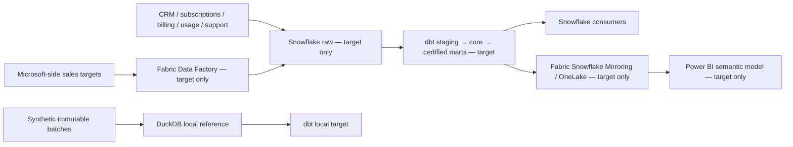

# Global SaaS Revenue & Customer Intelligence Platform

**Status: Day 5 of 10 — under active development.** This is a synthetic, cloud-free analytics-engineering reference, not a deployed service or a claim of production operation.

## Business problem

A global B2B SaaS company needs consistent answers for recurring revenue, renewals, customer usage, support pressure, overdue invoices and sales-target attainment. Finance, Revenue Operations and Customer Success must share definitions rather than independently rebuild them in dashboards.

## Target architecture

Snowflake is the governed enterprise warehouse. dbt owns transformations, tests and certified business marts inside that warehouse. Microsoft Fabric Data Factory is the proposed integration route for Microsoft-side planning data. Only certified marts cross to Fabric Snowflake Mirroring/OneLake; a Power BI semantic model provides context-dependent measures. Fabric and Power BI do not reimplement foundational dbt business rules.



The local DuckDB path is the executable proof; it cannot establish Snowflake or Fabric runtime behaviour. A real mirror can incur Snowflake compute and Fabric capacity costs, so no mirror is configured here.

## Evidence boundary

| Category | Current position |
| --- | --- |
| Implemented and locally tested | Deterministic synthetic source contracts, nine validated staging models, current dimensions, merge-based invoice/usage/support facts, account-history snapshot, monthly MRR and movement facts, replay/backfill/schema-gate checks and dbt reconciliation tests. |
| Statically specified | Snowflake governance SQL and Snowflake/Fabric target topology only; no runnable cloud connection. |
| Production target, not deployed | Snowflake warehouse, Fabric Data Factory, Mirroring/OneLake and Power BI Service. |
| Not evidenced | Real customers, cloud execution, scale, cloud cost, SLA, performance or service-side security enforcement. |

See [architecture](docs/architecture.md), [safety](docs/safety.md) and the [10-day roadmap](docs/10-day-roadmap.md). No CV claim of a completed production platform is justified yet.

## Local run

Use the hash-locked `requirements.lock` in a local virtual environment. Then generate and validate a synthetic batch; the landing step refuses a failed contract:

```text
python -m data.generate_saas_batch --business-date 2026-10-09 --batch-id demo-1 --seed 17 --accounts 12 --scenario normal --output-root data/input
python -m local.landing --delivery data/input/business_date=2026-10-09/batch_id=demo-1 --database dbt/target/saas.duckdb
dbt build --project-dir dbt --profiles-dir dbt --target local
```

The `snowflake_static` profile contains deliberately fake identifiers. Do not run it or substitute real credentials. Day 2 completed initial staging and source DQ, plus [static Snowflake design examples](snowflake/README.md). Day 3 added the [dimensional core](docs/data-model.md). Day 4 added the [subscription MRR and movement contract](docs/revenue-contract.md). Day 5 added [incremental replay and account-history evidence](docs/incremental-processing.md). Business marts and Fabric artifacts remain planned. See the [source contract](docs/source-contracts.md). No historical as-of fact join is claimed.
