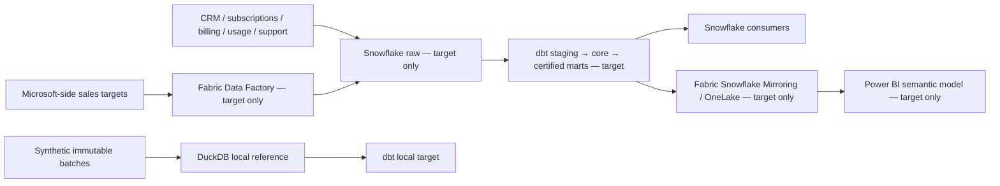

# Global SaaS Revenue & Customer Intelligence Platform

**Status: Day 1 of 10 — under active development.** This is a synthetic, cloud-free analytics-engineering reference, not a deployed service or a claim of production operation.

## Business problem

A global B2B SaaS company needs consistent answers for recurring revenue, renewals, customer usage, support pressure, overdue invoices and sales-target attainment. Finance, Revenue Operations and Customer Success must share definitions rather than independently rebuild them in dashboards.

## Target architecture

Snowflake is the governed enterprise warehouse. dbt owns transformations, tests and certified business marts inside that warehouse. Microsoft Fabric Data Factory is the proposed integration route for Microsoft-side planning data. Only certified marts cross to Fabric Snowflake Mirroring/OneLake; a Power BI semantic model provides context-dependent measures. Fabric and Power BI do not reimplement foundational dbt business rules.

The local DuckDB path is the executable proof; it cannot establish Snowflake or Fabric runtime behaviour. A real mirror can incur Snowflake compute and Fabric capacity costs, so no mirror is configured here.

## Evidence boundary

| Category | Day-1 position |
| --- | --- |
| Implemented and locally tested | Repository safety checks, deterministic synthetic source contracts and local dbt foundation after the second Day-1 commit. |
| Statically specified | Snowflake/Fabric target topology only; no runnable cloud connection. |
| Production target, not deployed | Snowflake warehouse, Fabric Data Factory, Mirroring/OneLake and Power BI Service. |
| Not evidenced | Real customers, cloud execution, scale, cloud cost, SLA, performance or service-side security enforcement. |

See [architecture](docs/architecture.md), [safety](docs/safety.md) and the [10-day roadmap](docs/10-day-roadmap.md). No CV claim of a completed production platform is justified yet.
